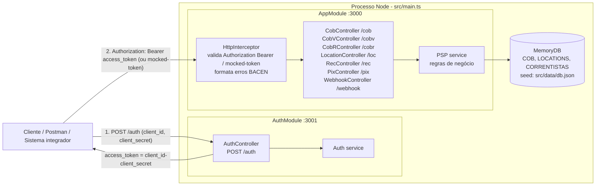

# Arquitetura do PIX Mocked Server

> Documento de análise arquitetural gerado a partir da leitura do código (`src/`, `test/`, `package.json`, `dockerfile`, `.devcontainer/`, `jest.config.ts`).
> Sempre que o código mudar, atualize este arquivo junto com a mudança.

## 1. Propósito

O projeto (`package.json` → `psp-api`) é um **mock da API Pix do Banco Central do Brasil (BACEN)**, seguindo o swagger oficial em <https://bacen.github.io/pix-api/>.
Seu objetivo é permitir **desenvolvimento e testes locais de integrações Pix sem depender das sandboxes dos bancos/PSPs** (que costumam ser instáveis ou incompletas). Ele simula:

- o fluxo de autenticação OAuth2 `client_credentials` de um PSP;
- os recursos de cobrança (`cob`, `cobv`, `cobr`), locations (`loc`), recorrências (`rec`), Pix recebidos (`pix`) e webhooks (`webhook`);
- o formato de erro padronizado do BACEN (`https://pix.bcb.gov.br/api/v2/error/...`) com `violacoes`.

Não há banco de dados nem integração externa: tudo vive em memória e é perdido ao reiniciar o processo.

## 2. Stack

| Item | Versão / Ferramenta |
| --- | --- |
| Runtime | Node.js 20 (`dockerfile`, `.devcontainer/devcontainer.json`) |
| Framework | NestJS 10 (`@nestjs/common`, `@nestjs/core`, `@nestjs/platform-express`) |
| Linguagem | TypeScript 5 (`target: ES2021`, `module: commonjs`, `strictNullChecks: false`, `noImplicitAny: false`) |
| Validação | `class-validator` + `class-transformer` + validadores customizados em `src/validators/custom-validators.ts` |
| Documentação | `@nestjs/swagger` 7 (Swagger UI em `/api-docs` nos dois servidores) |
| Testes | Jest 29 + `ts-jest` + `supertest` + `@nestjs/testing` |
| Qualidade | ESLint 8 (`@typescript-eslint` + `plugin:prettier/recommended`) e Prettier 3 |

## 3. Topologia dual-server

`src/main.ts` sobe **duas aplicações Nest independentes no mesmo processo Node**:



| Servidor | Porta | Módulo | Swagger | Config Swagger |
| --- | --- | --- | --- | --- |
| API Principal | `3000` | `AppModule` (`src/app.module.ts`) | <http://localhost:3000/api-docs> | `src/swagger-app.config.ts` |
| Serviço de Autenticação | `3001` | `AuthModule` (`src/auth.module.ts`) | <http://localhost:3001/api-docs> | `src/swagger-auth.config.ts` |

Ordem de bootstrap em `src/main.ts`:

1. Cria as coleções `COB` (sortKey `txid`), `LOCATIONS` (`id`, `uuid`) e `CORRENTISTAS` (`chave`) no `MemoryDB`.
2. Popula `CORRENTISTAS` no cluster `"DEV"` com `correntistas` de `src/data/db.json`.
3. Cria o `AppModule`, registra `ValidationPipe` global, publica Swagger e escuta em `3000`.
4. Cria o `AuthModule`, publica Swagger e escuta em `3001`.

## 4. Módulos e camadas

```
src/
├── main.ts                    # bootstrap dos 2 servidores + seed do MemoryDB
├── app.module.ts              # AppModule: CobController, CobVController, LocationController, RecController + PSP
├── auth.module.ts             # AuthModule: AuthController + Auth
├── http.interceptor.ts        # autenticação por header e tradução de erros para o padrão BACEN
├── swagger-app.config.ts      # DocumentBuilder da API principal (bearer "access-token")
├── swagger-auth.config.ts     # DocumentBuilder do auth (oauth2 clientCredentials, tokenUrl /auth)
├── controllers/               # camada HTTP (rotas Nest)
│   ├── auth.controller.ts / auth.models.ts
│   ├── cob.controller.ts      # /cob
│   ├── cobv.controller.ts     # /cobv
│   ├── cobr.controller.ts     # /cobr
│   ├── location.controller.ts # /loc
│   ├── rec.controller.ts      # /rec
│   ├── pix.controller.ts      # /pix
│   ├── webhook.controller.ts  # /webhook
│   └── fakedb.ts              # cópia legada de libs/fakedb.ts (não usada pelos módulos)
├── core/
│   ├── app/psp.ts             # serviço PSP: regras de cob/cobv/cobr/loc/rec/pix/webhook
│   ├── app/models.ts          # tipos/enum compartilhados (PixID, PixKey, TipoCob, Situacao, Pessoa...)
│   ├── app/models/{cob,cobv,cobr,loc,rec,pix,webhook}.ts  # DTOs com decorators class-validator
│   └── auth/auth.ts           # serviço Auth (valida client_id/secret contra owners)
├── libs/
│   ├── fakedb.ts              # MemoryDB
│   ├── messages.ts            # VALIDATORS (regex) e MESSAGES (textos de erro)
│   ├── documentos.ts          # gerar/validar CPF e CNPJ
│   └── utils.ts               # QRCode/CRC, datas (addDays, flatDate), getMD5Hash, errorFormatter
├── validators/custom-validators.ts  # @IsDICTValid, @IsDICTExists, @IsCPFValid, @IsCNPJValid, @NotPast, @MinStringNumber, @IsIDRec...
└── data/
    ├── db.json                # seed: owners (credenciais) e correntistas (chaves DICT)
    └── municipios.json        # tabela UF/município IBGE
```

Fluxo de uma requisição na API principal:

1. `HttpInterceptor` (aplicado via `@UseInterceptors` em cada controller) lê o token de **`Authorization: Bearer <token>`** (ou, como fallback, do header **`mocked-token`**), procura o owner em `db.json.owners` e injeta `headers['IdOwner'] = owner.id`. Sem token válido → `401 AcessoNegado`.
2. `ValidationPipe` valida o DTO (`CobPutRequest`, `LocPutRequest`, `RecPostRequest` ...). As mensagens usam o placeholder `$$`, que o interceptor substitui por `<recurso>.<campo>` (ex.: `cob.valor.original`).
3. O controller monta um `PixRequest<T>` (`{ IdOwner, txid, data }`) e delega ao `PSP`.
4. O `PSP` lê/grava no `MemoryDB`, usando **`IdOwner` como clusterKey** (isolamento multi-tenant).
5. O interceptor converte respostas vazias de `GET/PATCH/DELETE` em `404 NaoEncontrado` e erros em payloads no padrão BACEN (`type`, `title`, `status`, `detail`, `violacoes`).

## 5. Recursos Pix implementados

| Recurso | Rota | Métodos expostos | Situação |
| --- | --- | --- | --- |
| Cobrança imediata (`cob`) | `/cob` | `PUT /cob/:txid`, `POST /cob` (txid gerado), `GET /cob/:txid[?revisao=n]`, `GET /cob` (filtro `inicio`, `fim`, `cpf`/`cnpj`, `locationPresente`, `paginacao`), `PATCH /cob/:txid`, `DELETE /cob/:txid` | Implementado. Cria location automaticamente, versiona revisões em `COB_HIST`, `calendario.expiracao` padrão 86400s. |
| Cobrança com vencimento (`cobv`) | `/cobv` | `PUT /cobv/:txid`, `GET /cobv/:txid`, `GET /cobv`, `PATCH /cobv/:txid`, `DELETE /cobv/:txid` | Implementado (`valor.multa`, `valor.juros`, `valor.desconto`, `valor.abatimento`). `calendario.dataDeVencimento` não pode ser passada (`@NotPast`). Persiste na mesma coleção `COB`. |
| Cobrança recorrente (`cobr`) | `/cobr` | `PUT /cobr/:txid`, `POST /cobr`, `GET /cobr/:txid`, `GET /cobr` (filtro `inicio`, `fim`, `idRec`, `cpf`/`cnpj` do devedor da `rec`, `status`, `paginacao`), `PATCH /cobr/:txid` (só `status: CANCELADA`), `POST /cobr/:txid/retentativa/:data` (`YYYY-MM-DD`) | Implementado. Exige `idRec` existente; status inicial `CRIADA`; herda `politicaRetentativa` da `rec`; retentativa só com `PERMITE_3R_7D` (máx. 3). Não há `DELETE` (não existe na spec). |
| Location (`loc`) | `/loc` | `PUT /loc` (body `{ tipoCob: "cob" \| "cobv" }`), `GET /loc/:id`, `GET /loc` (filtro `tipoCob`, `txIdPresente`), `DELETE /loc/:id/txid` (desvincula cobrança) | Implementado. `location` = `pix.example.com/qr/<uuid>`. |
| Recorrência (`rec`) | `/rec` | `POST /rec`, `GET /rec/:idRec`, `GET /rec` (filtro `inicio`, `fim`, `cpf`/`cnpj` do devedor, `status`, `paginacao`), `PATCH /rec/:idRec` (`status: CANCELADA`, `vinculo.devedor.nome`, `calendario.dataInicial`), `GET /rec/:idRec/ativacao` (extensão do mock) | Implementado. `idRec` = `R` + (`N`\|`R` conforme `politicaRetentativa`) + `ISPB` do owner + `YYYYMMDD` + 11 alfanuméricos; status inicial `CRIADA`. |
| Pix recebidos (`pix`) | `/pix` | `GET /pix/:e2eid`, `GET /pix` (filtro `inicio`, `fim`, `txid`, `txIdPresente`, `devolucaoPresente`, `cpf`/`cnpj` do pagador, `paginacao`) | Implementado. Um Pix é registrado quando uma `cob`/`cobv` recebe `PATCH { status: "CONCLUIDA" }` (simulação de pagamento); `endToEndId` = `E` + ISPB + `YYYYMMDDHHmm` + 11 alfanuméricos. |
| Webhooks (`webhook`) | `/webhook` | `PUT /webhook/:chave` (body `{ webhookUrl }`), `GET /webhook/:chave`, `DELETE /webhook/:chave` (204), `GET /webhook` | Implementado. `chave` deve existir em `CORRENTISTAS`. Não há disparo real de notificações. |
| Autenticação | `:3001/auth` | `POST /auth` | Implementado (ver seção 6). |

> `DELETE /cob/:txid` e `DELETE /cobv/:txid` (métodos `remove`) são uma extensão do mock e **não existem na API oficial do BACEN**, onde a remoção é feita via `PATCH` com `status: REMOVIDA_PELO_USUARIO_RECEBEDOR`.

## 6. Autenticação OAuth2 mockada

- Endpoint: `POST http://localhost:3001/auth` com body JSON `{ "grant_type": "client_credentials", "client_id": "...", "client_secret": "..." }` (`ValidateInput` em `src/controllers/auth.models.ts`).
- `Auth.validate` (`src/core/auth/auth.ts`) espera **2 s** (simula latência) e monta o token como `` `${client_id}-${client_secret}` ``; se existir em `db.json.owners[].token` retorna, senão rejeita.
- Resposta (HTTP 201): `{ "access_token": "123-abc", "accesstoken": "123-abc", "expires_in": 300 }` (`accesstoken` mantido por compatibilidade). Não há expiração real.
- Na API principal o token é enviado em **`Authorization: Bearer <token>`**; o header **`mocked-token`** continua aceito como fallback.

Credenciais disponíveis (`src/data/db.json` → `owners`):

| client_id | client_secret | mocked-token | ISPB |
| --- | --- | --- | --- |
| `123` | `abc` | `123-abc` | `0d9094da` |
| `456` | `def` | `456-def` | `4aa5cce5` |
| `789` | `ghi` | `789-ghi` | `84dc48b6` |
| `012` | `fab` | `012-fab` | — |
| `345` | `cde` | `345-cde` | — |

> Owners sem `ISPB` geram `idRec` inválido em `POST /rec`.

## 7. Persistência em memória (`MemoryDB`) e seed

`src/libs/fakedb.ts` implementa um "banco" estático em memória:

- `MemoryDB.create(nome, sortKeys)` registra uma coleção global (erro `Duplicate Collection` se repetida; `Sort Key Required` se `sortKeys` vazio). `MemoryDB.get(nome)` recupera.
- Cada coleção é particionada por **clusterKey** (na prática, o `IdOwner` do tenant; `"DEV"` para correntistas).
- Operações assíncronas: `add` (valida sortKey, `Duplicate Key`), `read(cluster, {sortKey: valor})`, `patch` (merge), `update` (substituição), `list` (ordena pelo 1º sortKey), `remove`.

Coleções usadas pelo `PSP`:

| Coleção | SortKeys | Uso | Criada no bootstrap (`src/bootstrap.ts`)? |
| --- | --- | --- | --- |
| `CORRENTISTAS` | `chave`, `cpfcnpj` | chaves DICT válidas (seed `db.json.correntistas`) | Sim |
| `COB` | `txid` | cobranças `cob` e `cobv` | Sim |
| `LOCATIONS` | `id`, `uuid` | locations; `id = Date.now()` (com delay de 100 ms para evitar colisão) | Sim |
| `LOC_COB` | `id`, `txid` | vínculo location ↔ cobrança | Sim |
| `COB_HIST` | `id` (`md5(txid, revisao)`) | histórico de revisões | Sim |
| `COBR` | `txid` | cobranças recorrentes | Sim |
| `WEBHOOK` | `chave` | webhooks por chave Pix | Sim |
| `PIX` | `e2eid` | Pix recebidos | Sim |
| `REC` | `idRec` | recorrências | Sim |

Seed (`src/data/db.json`): 5 `owners` (credenciais/tenants) e 3 `correntistas` (chaves aleatórias DICT com CPF/CNPJ, nome e cidade). As cobranças só aceitam `chave` presente em `CORRENTISTAS` (`@IsDICTExists`).

## 8. Swagger

- `SwaggerModule.setup('api-docs', ...)` em ambos os servidores.
- API principal: título "PIX Mocked Server - API Principal", link para a doc oficial, esquema bearer `access-token`, servidor `http://localhost:3000`.
- Auth: título "PIX Mocked Server - Autenticação", esquema `oauth2` `clientCredentials` com `tokenUrl: /auth`, servidor `http://localhost:3001`.
- DTOs documentados via `@ApiProperty` (ex.: `auth.models.ts`, `models/cob.ts`).

## 9. Como rodar e testar

Resumo (detalhes em [`setup.md`](./setup.md)):

```bash
npm ci
npm run start:dev          # watch mode, sobe :3000 e :3001
npm run build              # gera dist/main.js
npm run start:prod         # node dist/main
npm test                   # Jest com cobertura (266 testes em 16 suites)
npm run test:e2e           # só as suítes *.e2e.test.ts
docker build -t pix-mocked-server . && docker run -p 3000:3000 -p 3001:3001 pix-mocked-server
```

Testes (`jest.config.ts`, preset `ts-jest`, `collectCoverage: true`, saída em `coverage/`):

- `test/*.e2e.test.ts` — sobem `AppModule` com `supertest` (cob, cobv, loc, rec). `test/bootstrap.e2e.test.ts` usa `setupDatabase()`/`createValidationPipe()` de `src/bootstrap.ts`, a mesma configuração do `main.ts`.
- `test/controllers/*.test.ts` — instanciam controllers + `PSP` via `Test.createTestingModule`.
- `test/core/**`, `test/libs/**`, `test/validators/**` — unitários de `MemoryDB`, `PSP`, utils, mensagens e validadores.
- `test/e2e.ts` — helpers `expectPost200/201/400/401` e o genérico `expectRequest(app, { method, endpoint, status, payload, query, expected, token })` (usam `mocked-token: 123-abc`).
- `test/fixtures.ts` — `newTxid()` e `buildRec()` (payload válido de recorrência).

## 10. Limitações e pontos de atenção conhecidos

1. **Webhooks** são apenas cadastrados; o mock não envia notificações para `webhookUrl`.
2. **Pix**: devoluções (`/pix/:e2eid/devolucao`) não implementadas; `devolucaoPresente=true` sempre retorna lista vazia.
3. **Lint**: o código atual não segue o Prettier (≈2.9k erros de `eslint` sem `--fix`). `npm run lint` usa `--fix` e reformataria o repositório inteiro — rode apenas nos arquivos alterados.
4. `src/controllers/fakedb.ts` é uma cópia de `src/libs/fakedb.ts` não utilizada; sempre importe de `src/libs/fakedb`.
5. Ao criar coleções novas no `PSP`, registre-as em `COLLECTIONS` (`src/bootstrap.ts`); os testes que criam coleções manualmente não detectam a ausência no bootstrap real.
6. Imports dentro de `src/` devem ser relativos ao próprio arquivo (nunca `../../src/...`): o `dockerfile` copia o conteúdo de `src/` achatado em `/app`.
