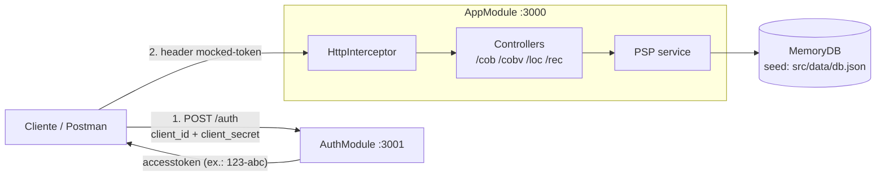

#MOCKED PIX SERVER
Por falta de uma Sandbox decente dos bancos, resolvi iniciar esse projeto.


1. Queria agradecer imensamente ao Dr. h.c. Nubio Revoredo por toda a mentoria e paciência
2. Estou seguindo com esse projeto nas horas vagas. Então, não sei quando ficará concluído
3. Toda ajuda é bem vinda.

Swagger utilizado para implementar as funcionalidades estão em:
https://bacen.github.io/pix-api/

# PARA REALIZAR AS CHAMADAS
## AUTENTICAÇÃO
> ### http://localhost:3001/api-docs#/   
>
> INFORME AS POSSÍVEIS COMBINAÇÕES
> 
> `{"grant_type": "client_credentials", client_id: '123', client_secret: 'abc'} `
>
> `{"grant_type": "client_credentials", client_id: '456', client_secret: 'def'} `  

## API
> ### http://localhost:3000/api-docs#/
> 
> UTILIZE O POSTMAN PARA REALIZAR AS REQUISIÇÕES   

---

# VISÃO GERAL DA ARQUITETURA

O servidor é um mock da API Pix do BACEN para desenvolvimento local, sem depender das sandboxes dos bancos.
Escrito em **NestJS 10 / TypeScript / Node.js 20**, sobe **dois servidores no mesmo processo** (`src/main.ts`):

| Servidor | Porta | Módulo | Swagger | Responsabilidade |
| --- | --- | --- | --- | --- |
| API Principal | `3000` | `AppModule` (`src/app.module.ts`) | http://localhost:3000/api-docs | Recursos Pix (`cob`, `cobv`, `loc`, `rec`) |
| Serviço de Autenticação | `3001` | `AuthModule` (`src/auth.module.ts`) | http://localhost:3001/api-docs | OAuth2 `client_credentials` mockado (`POST /auth`) |

Os dados ficam em memória (`MemoryDB`, `src/libs/fakedb.ts`), isolados por tenant (`IdOwner`) e populados a partir de `src/data/db.json` na inicialização. Tudo é perdido ao reiniciar.



Fluxo de autenticação: o token retornado por `POST /auth` é `client_id-client_secret` (ex.: `123-abc`) e deve ser enviado na API principal no header **`mocked-token`**. Sem ele a resposta é `401 AcessoNegado`. Credenciais disponíveis: `123/abc`, `456/def`, `789/ghi`, `012/fab`, `345/cde`.

## RECURSOS PIX SUPORTADOS

| Recurso | Rota | Operações | Status |
| --- | --- | --- | --- |
| Cobrança imediata | `/cob` | `PUT /cob/:txid`, `POST /cob`, `GET /cob/:txid`, `GET /cob`, `PATCH /cob/:txid` | Implementado (com revisões e location automática) |
| Cobrança com vencimento | `/cobv` | `PUT /cobv/:txid`, `GET /cobv/:txid`, `GET /cobv`, `PATCH /cobv/:txid` | Implementado (multa, juros, desconto) |
| Location (payload QR Code) | `/loc` | `PUT /loc`, `GET /loc/:id`, `GET /loc`, `DELETE /loc/:id/txid` | Implementado |
| Recorrência | `/rec` | `POST /rec` | Implementado (criação) |
| Cobrança recorrente | `/cobr` | — | Em desenvolvimento (controller não registrado) |
| Webhooks | — | — | Não implementado |
| Autenticação | `:3001/auth` | `POST /auth` | Implementado |

Erros seguem o padrão BACEN (`type`, `title`, `status`, `detail`, `violacoes`).

## INFRAESTRUTURA E EXECUÇÃO

### npm

```bash
npm ci
npm run start:dev     # sobe :3000 e :3001 em watch mode
npm run build         # compila para dist/ (entrypoint: dist/src/main.js)
npm test              # Jest + cobertura (coverage/)
```

| Script | Uso |
| --- | --- |
| `start` / `start:dev` / `start:debug` | Sobe os dois servidores (normal / watch / debug) |
| `start:prod` | `node dist/main` (no build local use `node dist/src/main.js`) |
| `build` | `nest build` |
| `test` / `test:watch` / `test:cov` / `test:debug` | Testes Jest |
| `lint` / `format` | ESLint (`--fix`) e Prettier — reescrevem os arquivos |

### Docker

```bash
docker build -t pix-mocked-server .
docker run --rm -p 3000:3000 -p 3001:3001 pix-mocked-server
```

Build multi-stage: `node:20` para instalar/compilar e `node:20.16.0-alpine` na imagem final, expondo `3000` e `3001`.

> **Atenção:** no estado atual o `docker build` falha no estágio `build` (`TS2307: Cannot find module '../../src/core/app/models/loc'`), porque `src/controllers/location.controller.ts` importa via `../../src/...` e o `dockerfile` copia o conteúdo de `src/` achatado em `/app`. Trocar esses imports por caminhos relativos (`../core/app/models/loc`, `../core/app/psp`, `../http.interceptor`) resolve.

### Devcontainer

Abra o projeto no VS Code com *Dev Containers: Reopen in Container*. A imagem `node:20` executa `npm i -g @nestjs/cli && npm i` ao criar o container; depois rode `npm run start:dev`.

## ESTRUTURA DE PASTAS

```
.
├── .devin/                  # harness de IA (ver .devin/README.md)
│   ├── agents/              # agentes especializados (api-analyst, test-engineer)
│   ├── instructions/        # architecture.md, setup.md
│   ├── prompts/             # prompts recorrentes (analyze-endpoint, add-pix-resource)
│   ├── rules/               # code-style, testing, nestjs-conventions
│   └── skills/              # run-tests, start-server, swagger-docs, build-docker
├── .devcontainer/           # devcontainer.json (node:20)
├── src/
│   ├── main.ts              # bootstrap dos servidores 3000 e 3001 + seed do MemoryDB
│   ├── app.module.ts        # AppModule (API Pix)
│   ├── auth.module.ts       # AuthModule (OAuth2 mock)
│   ├── http.interceptor.ts  # autenticação por mocked-token e erros no padrão BACEN
│   ├── swagger-*.config.ts  # configuração Swagger de cada servidor
│   ├── controllers/         # rotas HTTP (cob, cobv, cobr, loc, rec, auth)
│   ├── core/app/            # PSP (regras de negócio) e DTOs
│   ├── core/auth/           # serviço de autenticação
│   ├── libs/                # MemoryDB, mensagens, CPF/CNPJ, utils
│   ├── validators/          # validadores class-validator customizados
│   └── data/                # db.json (owners e correntistas), municipios.json
├── test/                    # testes Jest (e2e, controllers, unitários)
├── dockerfile
├── jest.config.ts
└── package.json
```

## DOCUMENTAÇÃO PARA DESENVOLVEDORES E AGENTES DE IA

- Análise arquitetural completa (módulos, recursos, autenticação, persistência, limitações conhecidas): [`.devin/instructions/architecture.md`](.devin/instructions/architecture.md)
- Setup detalhado e troubleshooting: [`.devin/instructions/setup.md`](.devin/instructions/setup.md)
- Índice do harness de IA: [`.devin/README.md`](.devin/README.md)
